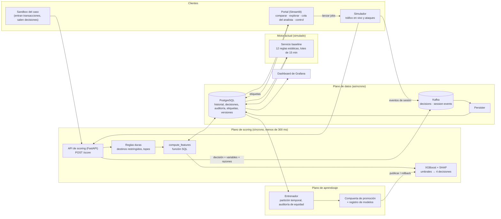
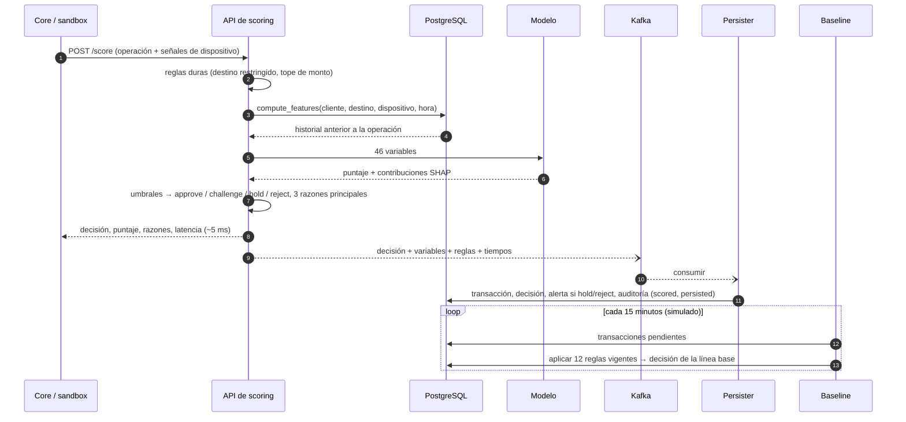
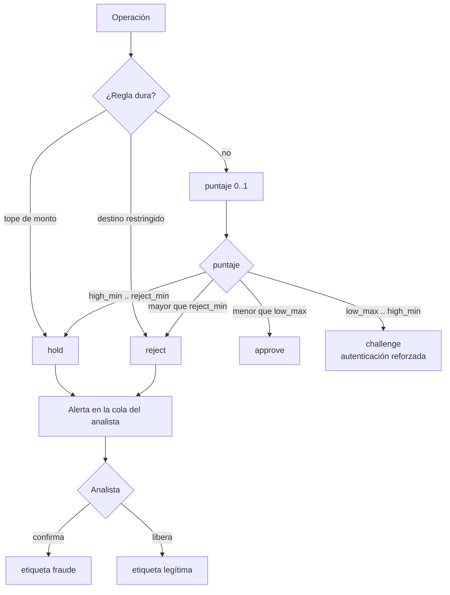
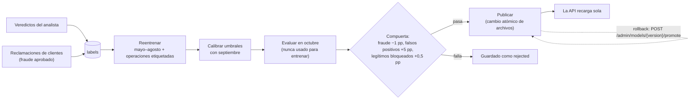
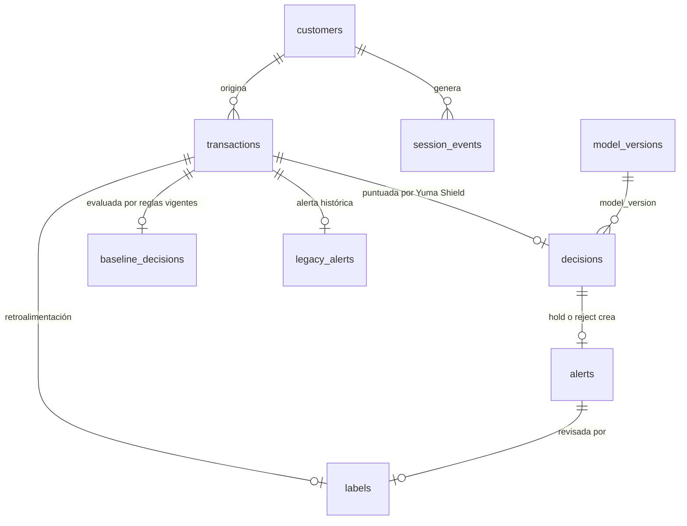

# Arquitectura

Cómo funciona Yuma Shield hoy. Este documento reemplaza las notas iniciales de alcance de [CONTEXT.md](CONTEXT.md). Los diagramas son Mermaid: GitHub los renderiza y draw.io puede importarlos (Organizar → Insertar → Avanzado → Mermaid).

## 1. Componentes

| Componente | Carpeta | Función |
|------------|---------|---------|
| API de scoring | `services/api/app` | Decide cada operación antes de autorizarla |
| Persister | `services/api/app/workers/persister.py` | Guarda decisiones, transacciones, eventos de sesión y rastro de auditoría desde Kafka |
| Baseline | `services/baseline` | Reproduce las 12 reglas vigentes del caso en lotes de 15 minutos |
| Simulador | `services/simulator` | Tráfico en vivo, cinco tipos de ataque, conector del sandbox, servicio de control HTTP |
| Portal | `services/portal` | Comparación, explorador de transacciones, cola del analista, control y versiones del modelo |
| Entrenador / registro | `ml/shield_ml` | Variables, entrenamiento, auditoría de equidad, versiones del modelo, compuerta de promoción |
| Base de datos | `infra/postgres/init` | Esquema, `compute_features`, vista de comparación |
| Dashboard | `infra/grafana` | Paneles operativos y de comparación |

## 2. Vida de una transacción

Puntos clave:

- **Solo se usa el pasado.** `compute_features` filtra cada ventana con `occurred_at < hora de la operación`, tanto al entrenar como al servir.
- **Una sola definición de variables.** La misma función SQL y el mismo Python (`ml/shield_ml/features.py`) alimentan el entrenamiento, el scoring y el replay masivo, por lo que no pueden desalinearse.
- **La persistencia no está en el camino crítico.** La API responde primero y publica en Kafka después.

## 3. Bandas de decisión

Una decisión automática nunca cierra una cuenta: el bloqueo definitivo siempre es una decisión humana. Los umbrales viven en `config/thresholds.yaml` (no versionado) y se calibran con los datos de septiembre.

## 4. Ciclo de retroalimentación y vida del modelo

Cada versión se conserva en `ml/artifacts/models/<versión>/` y en la tabla `model_versions`, con sus métricas, el feedback que usó y el resultado de la compuerta.

## 5. Modelo de datos

| Tabla | Contenido |
|-------|-----------|
| `transactions` | Operaciones con las señales entregadas por el caso; `is_fraud` es la verdad de terreno y nunca una variable |
| `session_events` | Inicios de sesión (fallidos y exitosos), registros de dispositivo, cambios de clave y de SIM |
| `decisions` | Acción, puntaje, razones, **todos los valores de las variables**, reglas evaluadas, tiempos por etapa, versión del modelo |
| `baseline_decisions` | Decisión de la línea base con las reglas que se activaron |
| `alerts`, `labels` | Cola del analista y retroalimentación (veredictos de analistas y reclamaciones de clientes) |
| `model_versions` | Registro con métricas, umbrales, feedback usado, resultado de la compuerta y estado |
| `audit_log` | Solo se añade (un trigger bloquea actualizaciones y borrados): `scored` por la API, `persisted` con partición, offset y retraso de Kafka, modelo entrenado o promovido, alerta revisada |
| `legacy_rules`, `legacy_alerts` | Catálogo del caso y alertas históricas, usados para explicar y para validar la línea base |

## 6. Correspondencia con la arquitectura objetivo del caso

| Componente del caso | Aquí |
|---------------------|------|
| El orquestador pide un puntaje antes de autorizar, síncrono < 300 ms | `POST /score` |
| Motor de reglas en tiempo real | Reglas duras en la API |
| Modelo de aprendizaje automático | XGBoost |
| Perfil de comportamiento y dispositivo | Variables de historial: operaciones, inicios de sesión fallidos, antigüedad del dispositivo, cambios de clave y de SIM |
| Análisis de redes (cuentas mula) | Variables sobre emisores por destino y dinero recibido por cliente, en ventanas SQL (sin base de grafos) |
| Almacén de variables en línea | `compute_features` sobre tablas de PostgreSQL indexadas |
| Bus de eventos | Kafka (`decisions`, `session-events`) |
| Gestión de casos con explicación | Cola del analista con razones en lenguaje claro |
| Las etiquetas confirmadas retroalimentan | `labels` → reentrenamiento con compuerta de promoción |
| Observabilidad y auditoría de cada decisión | Grafana, explorador del portal, `audit_log` |

## 7. Comportamiento medido

- **Latencia:** p95 de 10,4 ms para el cliente y de 6,2 ms dentro de la API con 150 TPS sostenidos 60 s, con un pico de 200 TPS y sin errores. Detalle en [loadtest/RESULTS.md](../loadtest/RESULTS.md).
- **Efectividad (sandbox oficial, octubre):** 98,8 % del fraude detectado y 25,9 % de falsos positivos, frente al 62,6 % y 89,0 % del motor actual en la muestra del caso.
- **Equidad:** `department` y `age_range` nunca son entradas del modelo; `ml/artifacts/fairness.json` reporta las tasas de bloqueo y marcación por grupo.

## 8. Brechas conocidas

- **Cifrado:** el tráfico entre servicios es HTTP plano y PostgreSQL no usa TLS ni cifrado de disco en este prototipo. El caso exige cifrado en tránsito y en reposo; en producción implicaría TLS en la pasarela y entre servicios, y almacenamiento cifrado.
- **Autenticación:** la API, el servicio de control y el portal no tienen autenticación.
- **Un solo nodo:** un broker, un PostgreSQL, sin replicación. Escalar implica particionar el topic, agregar réplicas de la API y una réplica de lectura para las variables.
- **Datos sintéticos:** la prevalencia de fraude en la muestra es 1,41 % frente a ~0,01 % en la realidad, por lo que los porcentajes de falsos positivos serían mucho mayores en producción para cualquier motor.
- **Ataques simulados:** son aproximaciones hechas a mano y no reemplazan la evaluación oficial.
