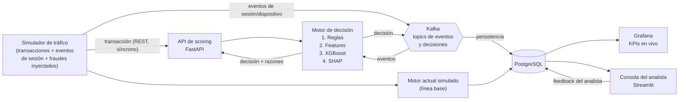
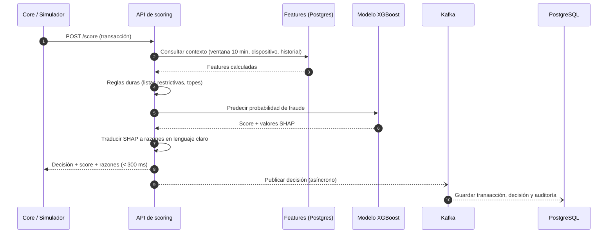
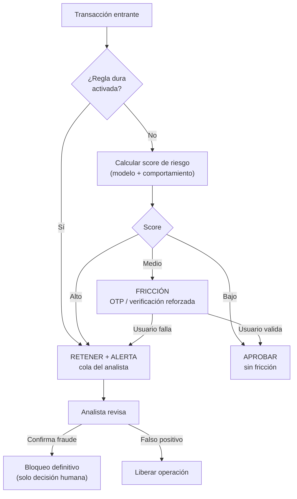
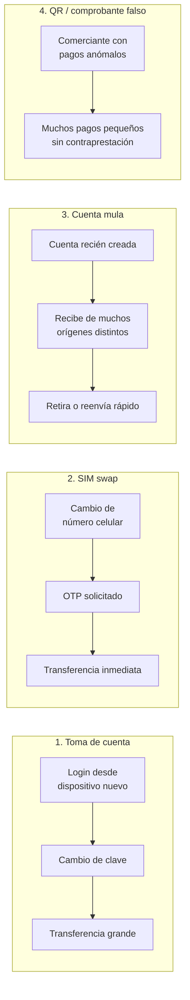
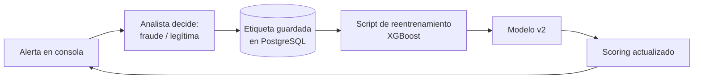
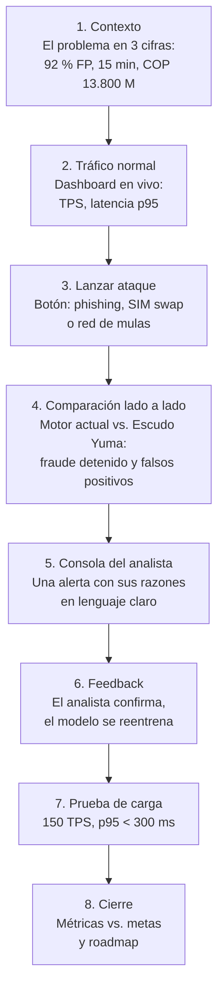
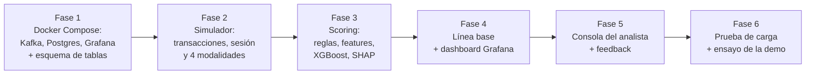
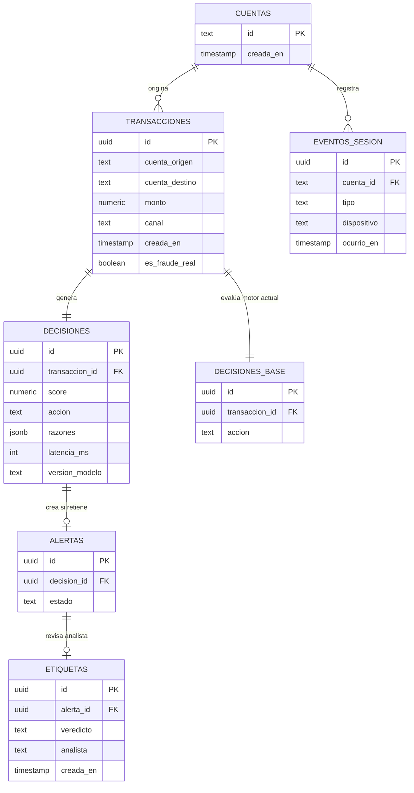

# Escudo Yuma — Alcance y Stack del MVP

> Sistema antifraude en tiempo real para Yuma Pay. Documento de definición del MVP para la hackatón EstudIA.

---

## 1. Qué problema resolvemos (y qué no)

El reto se reduce a **tres problemas reales**. Todo lo que entra al MVP debe resolver al menos uno; lo que no, se queda fuera.

| #   | Problema del caso                                                           | Cómo lo resolvemos en el MVP                                                               | Cómo se demuestra                                          |
| --- | --------------------------------------------------------------------------- | ------------------------------------------------------------------------------------------ | ---------------------------------------------------------- |
| P1  | El fraude se detecta **después** de que el dinero salió (lotes cada 15 min) | Scoring **antes de autorizar**, en < 300 ms                                                | Latencia p95 en vivo + prueba de 150 TPS                   |
| P2  | **92 % de falsos positivos**, 12 analistas revisan solo un tercio           | Modelo + comportamiento + dispositivo reducen alertas inútiles; cola priorizada por riesgo | Gráfica: falsos positivos del motor actual vs. Escudo Yuma |
| P3  | Decisiones **sin explicación** y **sin retroalimentación** a las reglas     | Razones en lenguaje claro por decisión + feedback del analista que reentrena el modelo     | Consola del analista + ciclo de feedback                   |

**Meta cuantitativa del caso:** bajar falsos positivos de 92 % a < 60 % **sin dejar pasar más fraude**.

---

## 2. Visión general de la arquitectura

**Por qué esta forma:** la calificación de la transacción es una llamada **síncrona** (el core necesita la respuesta antes de autorizar, y eso exige < 300 ms). Kafka se usa donde realmente aporta: ingestar eventos de sesión y dispositivo, y desacoplar la escritura de decisiones hacia Postgres para no sumar latencia al camino crítico.

---

## 3. Flujo de una transacción (camino crítico)

---

## 4. Lógica de decisión

Tres salidas posibles. **Nunca hay bloqueo definitivo automático**: el caso exige revisión de un analista.

> Los umbrales (bajo / medio / alto) viven en un archivo de configuración fuera del repositorio, porque el caso prohíbe publicar reglas y umbrales.

---

## 5. Las 4 modalidades de fraude y su señal de detección

Cada modalidad del caso se inyecta en el simulador con un patrón concreto y se detecta con features específicas.

| Modalidad         | Features que la detectan                                                                            |
| ----------------- | --------------------------------------------------------------------------------------------------- |
| Toma de cuenta    | Dispositivo nuevo, tiempo desde cambio de clave, monto vs. promedio histórico del usuario           |
| SIM swap          | Minutos desde cambio de número, OTP seguido de transferencia, hora inusual                          |
| Cuenta mula       | Edad de la cuenta, número de orígenes distintos hacia un destino en N minutos, ratio entrada/salida |
| QR / comprobantes | Frecuencia y monto de pagos por comerciante vs. su patrón, desviación por franja horaria            |

**Nota técnica:** la red de cuentas (mulas) se aproxima con consultas SQL sobre ventanas de tiempo. No se necesita base de grafos para el MVP.

---

## 6. Ciclo de retroalimentación

Resuelve la tercera limitación del caso: _"la retroalimentación de los casos confirmados no vuelve de forma automática a las reglas"_.

Alcance: un **script de reentrenamiento** ejecutable desde la demo. No se construye un pipeline MLOps completo.

---

## 7. Stack tecnológico

Todo open source, todo en contenedores, un solo `docker compose up`.

| Capa                   | Herramienta                             | Justificación                                                                              |
| ---------------------- | --------------------------------------- | ------------------------------------------------------------------------------------------ |
| Ingesta de eventos     | **Apache Kafka** (modo KRaft, 1 broker) | Cumple el requisito de integración por eventos; KRaft evita Zookeeper                      |
| Visualización de Kafka | **Kafka UI**                            | Muestra los mensajes fluyendo durante la demo                                              |
| Base de datos          | **PostgreSQL**                          | Transacciones, decisiones, alertas, etiquetas, auditoría y cálculo de features por ventana |
| API de scoring         | **Python + FastAPI**                    | Mismo lenguaje que el modelo, baja latencia, documentación automática (OpenAPI)            |
| Modelo                 | **XGBoost + scikit-learn**              | Estándar para fraude tabular; rápido en inferencia                                         |
| Explicabilidad         | **SHAP**                                | Cumple "decisiones explicables y auditables"                                               |
| Datos                  | **PaySim** + generador propio en Python | PaySim da volumen; el generador añade sesión, dispositivo y las 4 modalidades              |
| Consola del analista   | **Streamlit**                           | Cola, explicación y feedback en Python, sin backend aparte                                 |
| Dashboard de KPIs      | **Grafana** (datasource PostgreSQL)     | KPIs en vivo y comparación visual                                                          |
| Pruebas de carga       | **k6**                                  | Demuestra 150 TPS y p95 < 300 ms                                                           |
| Orquestación           | **Docker Compose**                      | Cumple "nube y contenedores"                                                               |

### Decisiones deliberadas de qué NO usar

| Herramienta        | Por qué no entra                                                                                                                                          |
| ------------------ | --------------------------------------------------------------------------------------------------------------------------------------------------------- |
| Redis              | Con índices bien diseñados, Postgres resuelve las ventanas de features a 150 TPS. Se añade solo si la prueba de carga no cumple                           |
| NestJS + Angular   | La consola son dos pantallas; Streamlit evita mantener un backend y un frontend aparte. Si el equipo prefiere Angular, es reemplazable sin tocar el resto |
| Neo4j              | Las redes de mulas se aproximan con SQL                                                                                                                   |
| Kubernetes, MLflow | Fuera de lo que exige el caso para un prototipo                                                                                                           |

---

## 8. Alcance del MVP

### Dentro

- Pipeline de scoring síncrono + ingesta de eventos por Kafka.
- Tres capas: reglas, features de comportamiento y dispositivo, modelo XGBoost.
- Las 4 modalidades del caso con datos sintéticos.
- Tres decisiones: aprobar, fricción, retener con alerta.
- Explicación en lenguaje claro por cada decisión.
- Motor actual simulado como **línea base** para comparar sobre los mismos datos.
- Auditoría completa en PostgreSQL.
- Consola del analista con feedback y reentrenamiento por script.
- Dashboard Grafana con comparación y panel de "lanzar ataque".
- Prueba de carga con k6.

### Fuera (roadmap)

- Integración con sistemas de producción y app móvil real.
- Biometría real.
- Base de datos de grafos.
- MLOps completo, Kubernetes, deep learning.

---

## 9. Requisitos del caso y cómo se cubren

| Requisito del caso                         | Cobertura                                                                      |
| ------------------------------------------ | ------------------------------------------------------------------------------ |
| Score en < 300 ms                          | API síncrona + features en Postgres indexado; medido con k6                    |
| Picos de 150 TPS                           | Prueba de carga k6                                                             |
| API REST o eventos                         | Ambas: REST para scoring, Kafka para eventos                                   |
| Nube y contenedores                        | Docker Compose, desplegable en cualquier VPS                                   |
| Cifrado en tránsito y reposo               | TLS en la API; cifrado de disco o `pgcrypto`; cuentas ya cifradas en los datos |
| Open source / licencias comerciales        | Todo el stack                                                                  |
| Decisiones explicables y auditables        | SHAP + razones + tabla de auditoría                                            |
| No discriminar por región, edad o ingresos | Esas variables se excluyen del modelo; verificación de equidad por segmento    |
| Bloqueo definitivo con revisión humana     | Solo el analista puede bloquear                                                |
| No aumentar fricción al legítimo           | La fricción se aplica solo en score medio; se mide la tasa de fricción         |
| Reglas y umbrales no públicos              | Configuración fuera del repositorio                                            |
| Datos solo en entorno de la hackatón       | Datos sintéticos, sin salida del entorno                                       |
| Viable en el tiempo de la hackatón         | Stack reducido, 3 servicios propios                                            |

---

## 10. Cómo se muestra el MVP (guion de demo)

### Pantallas

**Dashboard Grafana (una sola vista)**

- Transacciones por segundo y latencia p95.
- Falsos positivos: motor actual vs. Escudo Yuma, con la meta de 60 % marcada.
- Fraude detectado: motor actual vs. Escudo Yuma.
- COP protegidos acumulados.
- Distribución de decisiones (aprobar / fricción / retener).

**Consola del analista (Streamlit)**

- Cola ordenada por riesgo.
- Detalle de cada alerta: score, razones, historial reciente del usuario.
- Botones: confirmar fraude / liberar.
- Panel de control del simulador (lanzar ataque).

---

## 11. Métricas de éxito

| Métrica                              | Meta                                     | Fuente                                  |
| ------------------------------------ | ---------------------------------------- | --------------------------------------- |
| Latencia de scoring p95              | < 300 ms                                 | k6                                      |
| Carga sostenida                      | 150 TPS                                  | k6                                      |
| Falsos positivos                     | de 92 % a < 60 %                         | Comparación sobre el mismo set de datos |
| Fraude detectado vs. línea base      | Igual o mayor                            | Comparación sobre el mismo set de datos |
| Decisiones con explicación           | 100 %                                    | Tabla de auditoría                      |
| Tasa de fricción al usuario legítimo | Reportada, y menor a la de la línea base | Dashboard                               |

> **Honestidad sobre los resultados:** al ser datos sintéticos con patrones inyectados por nosotros, las métricas demuestran que la arquitectura funciona y que el enfoque es viable, no que el modelo generalizaría igual con datos reales. Conviene decirlo explícitamente en la presentación; el jurado lo valora más que ocultarlo.

---

## 12. Orden de construcción

**Regla de corte si falta tiempo:** las fases 1 a 4 ya cuentan la historia completa (detección previa, menos falsos positivos y comparación visual). La fase 5 completa el ciclo de explicabilidad y feedback. La fase 6 es la validación formal de los requisitos técnicos.

---

## 13. Tablas mínimas de PostgreSQL

`es_fraude_real` solo existe porque los datos son sintéticos: es la verdad de terreno para calcular las métricas.
